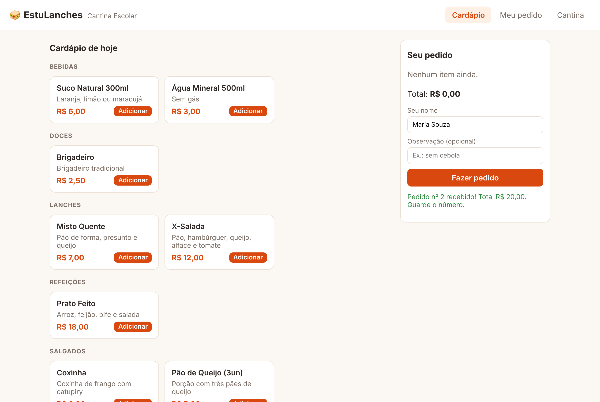
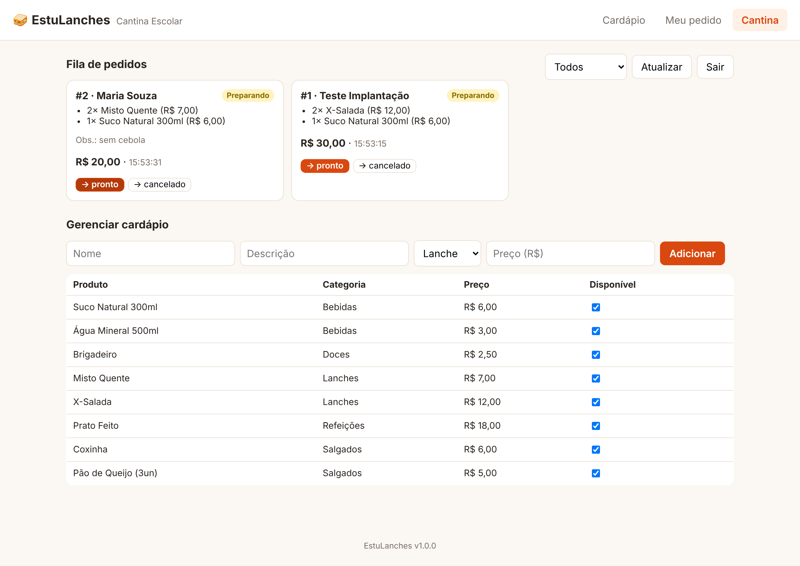

# 🥪 EstuLanches

Sistema de **gestão de cardápio e pedidos da cantina escolar**, implantado em produção com **Docker**.

> Autor: **Fernando Rateke Neto** · Versão **1.0.0**

## O problema

No intervalo, a cantina tem fila longa, pedidos anotados em papel, erros de troco/valor e alunos que não sabem se o lanche já está pronto.

## O que o EstuLanches resolve

| Quem | O que faz |
|---|---|
| **Aluno** | Vê o cardápio do dia, monta o pedido, recebe um número e acompanha o status (recebido → preparando → pronto → entregue). |
| **Cantina** | Vê a fila de pedidos, avança o status, cadastra produtos e marca itens como indisponíveis (acabou o salgado? some do cardápio na hora). |

O **preço e o total são calculados no servidor** e o valor de cada item fica "congelado" no pedido, então não há erro de conta e mudar o cardápio não altera pedidos antigos.




## Tecnologias

| Camada | Tecnologia | Por quê |
|---|---|---|
| Backend | **Node.js 22 + Express 5** | Leve, rápido para API REST, mesma linguagem do frontend |
| Banco | **PostgreSQL 16** | Relacional, transações ACID (pedido nunca fica "pela metade"), constraints |
| Frontend | HTML + CSS + JavaScript puro | Sem build, servido pela própria API |
| Segurança | Helmet, express-rate-limit | Cabeçalhos HTTP seguros e limite de requisições |
| Testes | Jest + Supertest | Unitários e de integração (com PostgreSQL real) |
| Infra | Docker (multi-stage) + Docker Compose | Ambiente reproduzível, isolado e versionado |

## Arquitetura

```
                 ┌──────────────── rede "frontend" ───────────────┐
 Navegador ──► :8080 ──► app (estulanches:1.0.0, Node, usuário node)│
                 └────────────────────────┬───────────────────────┘
                                          │ rede "backend" (internal: sem internet,
                                          ▼  sem porta publicada)
                              db (postgres:16-alpine) ──► volume db_data
```

```
src/
  server.js          # inicia: lê config, espera o banco, migra, sobe HTTP, desliga com SIGTERM
  app.js             # monta o Express (helmet, rate limit, rotas, erros)
  config.js          # configuração 100% por variáveis de ambiente
  db.js / migrate.js # pool do PostgreSQL, transações, migração com advisory lock
  domain/            # REGRAS DE NEGÓCIO puras (testes unitários)
  routes/            # endpoints REST (testes de integração)
  middleware/        # autenticação da cantina, logs, tratamento de erros
db/schema.sql        # tabelas produtos, pedidos, itens_pedido
db/seed.sql          # cardápio inicial
public/              # frontend
tests/unit/          # 43 testes unitários
tests/integration/   # 19 testes de integração
```

## Como rodar (produção)

Requisitos: Docker e Docker Compose.

```bash
cp .env.example .env
```

Edite o `.env` e troque `POSTGRES_PASSWORD` e `ADMIN_TOKEN`. Para gerar valores fortes: `openssl rand -hex 24`.

```bash
docker compose up -d --build
```

```bash
docker compose ps
```

```bash
docker compose logs app db
```

Acesse **http://localhost:8080**. A aba **Cantina** pede o `ADMIN_TOKEN` do `.env`.

Para parar (os dados ficam no volume `db_data`):

```bash
docker compose down
```

## Testes

Unitários e de integração rodam **dentro do Docker**, contra um PostgreSQL de teste descartável (em memória):

```bash
docker compose --profile test run --rm test
```

Resultado da implantação: **62/62 testes aprovados**, cobertura de 93% das linhas ([evidência](docs/evidencias/04-testes.txt)).

- **Unitários** (`tests/unit`): cálculo do total em centavos, validação de pedido e produto, fluxo de status, autenticação, configuração.
- **Integração** (`tests/integration`): API + banco reais. Fluxo completo do pedido, total calculado no servidor, preço congelado, transação desfeita em erro, transições inválidas, 401 sem token, SQL injection, rate limit (429), cabeçalhos de segurança.

## API

| Método | Rota | Acesso | Descrição |
|---|---|---|---|
| GET | `/health` | público | Saúde da app e do banco (usado pelo Docker HEALTHCHECK) |
| GET | `/api/produtos` | público | Cardápio (produtos disponíveis) |
| GET | `/api/produtos/:id` | público | Um produto |
| GET | `/api/produtos/todos` | cantina | Todos os produtos, inclusive indisponíveis |
| POST | `/api/produtos` | cantina | Cadastra produto |
| PATCH | `/api/produtos/:id` | cantina | Edita produto (preço, disponibilidade...) |
| DELETE | `/api/produtos/:id` | cantina | Remove (409 se já foi usado em pedido) |
| POST | `/api/pedidos` | público | Aluno faz pedido `{cliente_nome, observacao?, itens:[{produto_id, quantidade}]}` |
| GET | `/api/pedidos/:id` | público | Acompanhar pedido |
| GET | `/api/pedidos?status=` | cantina | Fila de pedidos |
| PATCH | `/api/pedidos/:id/status` | cantina | Avança status `{status}` |

Rotas de "cantina" exigem `Authorization: Bearer <ADMIN_TOKEN>`.

## Segurança

**Aplicação**
- Consultas SQL **parametrizadas** (`$1, $2`), o que impede SQL injection.
- **Validação** de todas as entradas (tipos, tamanhos, lista de categorias e status permitidos).
- Campos aceitos por lista fixa, sem *mass assignment*. **Total calculado no servidor**.
- **Token da cantina** comparado com `timingSafeEqual`. Em produção, a app não sobe se o token tiver menos de 16 caracteres.
- **Helmet**: Content-Security-Policy, HSTS, X-Frame-Options, nosniff. Também esconde o `X-Powered-By`.
- **Rate limit**: 300 req/15 min por IP e 20 pedidos/min por IP.
- Corpo JSON limitado a 10 KB. Erros 500 não expõem stack trace.
- Frontend usa `textContent` (nunca `innerHTML`) para os dados, o que evita XSS.

**Container / infraestrutura**
- Imagem `alpine` multi-stage: a final não tem dependências de desenvolvimento.
- Processo roda como usuário **não-root** (`node`, uid 1000). O código pertence ao root (só leitura).
- `read_only: true`, `cap_drop: ALL`, `no-new-privileges`, limites de CPU e memória.
- **Banco sem porta publicada**, em rede `internal`.
- Segredos no `.env`, fora do Git e da imagem (`.gitignore` e `.dockerignore`).

## Documentação da implantação

- [Ficha RDM (PDF)](docs/RDM-EstuLanches.pdf)
- [Evidências](docs/evidencias/): `docker compose ps`, logs, validação (smoke test) e testes
- [Escalabilidade para o Brasil todo](docs/escalabilidade.md)
- [Roteiro do vídeo](docs/roteiro-video.md)

### Build atrás de proxy com certificado próprio

Em redes de escola ou empresa com inspeção HTTPS, o `npm ci` pode falhar com `SELF_SIGNED_CERT_IN_CHAIN`. O Dockerfile aceita o certificado como *secret* opcional, que não fica gravado na imagem:

```bash
docker build --secret id=ca,src=/caminho/do/certificado.crt --target production -t estulanches:1.0.0 .
```
