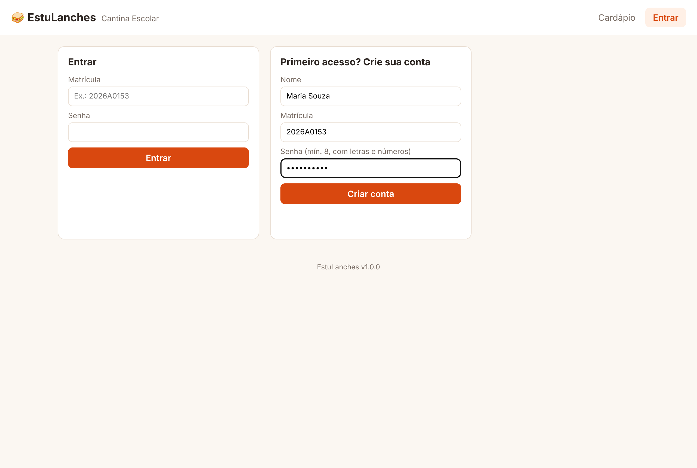
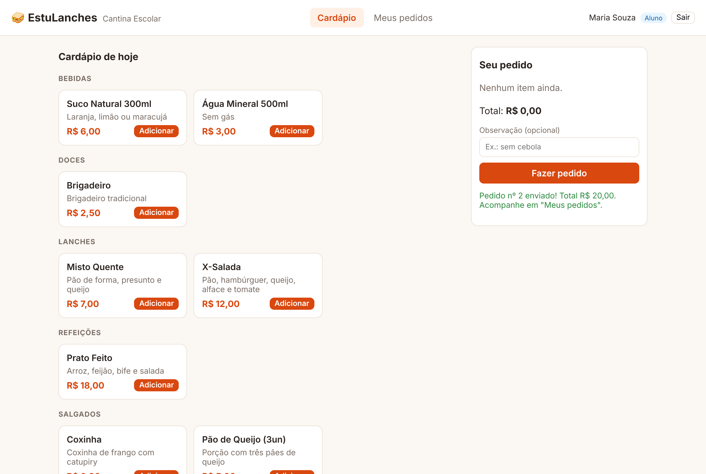
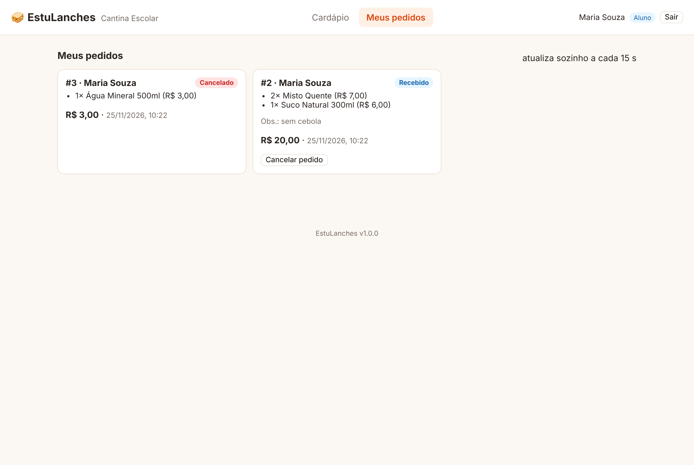

# 🥪 EstuLanches

Sistema de **gestão de cardápio e pedidos da cantina escolar**, implantado em produção com **Docker**.

> Autor: **Fernando Rateke Neto** · Versão **1.0.0**
>
> 🎥 Vídeo de apresentação: _(cole aqui o link do vídeo)_
>
> 📘 Nunca mexeu com Docker? Comece pelo **[Guia simples](docs/GUIA-SIMPLES.md)**.

## O problema

No intervalo, a cantina tem fila longa, pedido anotado em papel, erro de conta e aluno sem saber se o lanche já ficou pronto.

## O que o EstuLanches resolve

| Quem | O que faz |
|---|---|
| **Aluno** | Cria a conta com a **matrícula**, vê o cardápio, faz o pedido, acompanha o status em "Meus pedidos" e pode cancelar enquanto a cozinha ainda não começou. |
| **Cantina** | Entra com a conta da equipe, vê a fila de pedidos, avança o status (recebido → preparando → pronto → entregue), cadastra produtos e tira do cardápio o que acabou. |

O **preço e o total são calculados no servidor**, e o valor de cada item fica "congelado" no pedido.

| Entrar / criar conta | Cardápio e pedido |
|---|---|
|  |  |
| **Meus pedidos** | **Cantina** |
|  |  |

## Tecnologias e decisões

| Camada | Escolha | Por quê |
|---|---|---|
| Backend | **Node.js 22 + Express 5** | Leve e rápido para API REST; mesma linguagem do frontend |
| Banco | **PostgreSQL 16** com **SQL puro** (driver `pg`) | Transações (pedido nunca fica pela metade), regras no próprio banco (`CHECK`, `FOREIGN KEY`) e SQL visível, fácil de explicar |
| Evolução do banco | **Migrações versionadas** (`db/migrations/001_…sql`) | Cada mudança no banco vira um arquivo numerado; o sistema aplica só as novas e registra em `schema_migrations` |
| Login | **Sessões guardadas no banco** | Sair (logout) corta o acesso na hora; o banco guarda só o *hash* do código de sessão |
| Senhas | **scrypt** (nativo do Node) | Hash lento com sal aleatório, sem biblioteca extra |
| Frontend | HTML + CSS + JavaScript puro | Sem build; servido pela própria API |
| Proteções HTTP | Helmet, express-rate-limit | Cabeçalhos seguros e limite contra abuso e força bruta |
| Testes | Jest + Supertest | Unitários e de integração (com PostgreSQL real) |
| Infra | Docker multi-stage + Docker Compose | Ambiente igual em qualquer máquina, isolado e versionado |

## Arquitetura

```
                 ┌──────────────── rede "frontend" ────────────────┐
 Navegador ──► :8080 ──► app  (estulanches:1.0.0 · Node · usuário node)│
                 └─────────────────────────┬───────────────────────┘
                                           │ rede "backend" (internal: fechada,
                                           ▼  sem porta publicada)
                              db (postgres:16-alpine) ──► volume db_data
```

```
src/
  server.js              # liga tudo: config → espera o banco → migrações → HTTP → desliga com SIGTERM
  app.js                 # monta o Express: helmet, limites, "porteiros" de login e as rotas
  config.js              # configuração 100% por variáveis de ambiente
  db.js                  # pool de conexões e transações
  migrate.js             # executor das migrações versionadas + conta da cantina
  domain/                # REGRAS DE NEGÓCIO puras (cobertas por testes unitários)
    pedido.js            #   total em centavos, fluxo de status, validação
    produto.js           #   validação do cardápio
    usuario.js           #   validação de cadastro e login
  seguranca/             # senha (scrypt) e código de sessão
  middleware/            # exigirLogin, exigirPerfil, logs, tratamento de erros
  routes/                # endpoints: auth, produtos, pedidos
db/migrations/           # 001_usuarios_e_sessoes · 002_cardapio · 003_pedidos
db/seed.sql              # cardápio inicial
public/                  # frontend (uma página com abas)
tests/unit/              # 70 testes unitários
tests/integration/       # 32 testes de integração
```

## Como rodar (produção)

Requisitos: **Docker Desktop** (Windows/Mac) ou Docker Engine + Compose (Linux).

1. Crie o arquivo de senhas copiando o modelo:

```bash
cp .env.example .env
```

2. Abra o `.env` e troque `POSTGRES_PASSWORD` e `CANTINA_SENHA` (mínimo 10 caracteres).

3. Suba o sistema:

```bash
docker compose up -d --build
```

4. Confira o estado e os logs:

```bash
docker compose ps
```

```bash
docker compose logs app db
```

5. Acesse **http://localhost:8080**.
   - **Aluno:** aba **Entrar** → "Crie sua conta".
   - **Cantina:** aba **Entrar** → matrícula `cantina` + a `CANTINA_SENHA` do `.env`.

Parar (os dados continuam salvos no volume `db_data`):

```bash
docker compose down
```

## Testes

Rodam **dentro do Docker**, contra um PostgreSQL de teste descartável (em memória):

```bash
docker compose --profile test run --rm test
```

Resultado: **102/102 aprovados**, cobertura de 92% das linhas ([evidência](docs/evidencias/04-testes.txt)).

- **Unitários** (`tests/unit`, 70): total em centavos, validação de pedido, produto e cadastro, fluxo de status, cancelamento, hash de senha, código de sessão, middlewares de login e perfil (com `req`/`res` simulados) e configuração.
- **Integração** (`tests/integration`, 32): API + banco reais. Cadastro e login, mensagem igual para senha errada e matrícula inexistente, logout invalidando a sessão, sessão vencida, aluno sem acesso à cantina (403), aluno sem ver pedido de outro, fluxo completo do pedido, total calculado no servidor, preço congelado, transação desfeita em erro, migrações registradas, SQL injection, rate limit de login e de pedidos (429).

## API

| Método | Rota | Quem pode | Descrição |
|---|---|---|---|
| GET | `/health` | todos | Saúde da app e do banco (HEALTHCHECK do Docker) |
| POST | `/api/auth/cadastro` | todos | Aluno cria conta `{nome, matricula, senha}` e já sai logado |
| POST | `/api/auth/login` | todos | `{matricula, senha}` → `{usuario, token, expira_em}` |
| POST | `/api/auth/logout` | logado | Encerra a sessão |
| GET | `/api/auth/eu` | logado | Quem está logado |
| GET | `/api/produtos` | todos | Cardápio (produtos disponíveis) |
| GET | `/api/produtos/:id` | todos | Um produto |
| GET | `/api/produtos/todos` | cantina | Inclusive indisponíveis |
| POST · PATCH · DELETE | `/api/produtos[/:id]` | cantina | Cadastrar, editar, remover (409 se já usado em pedido) |
| POST | `/api/pedidos` | aluno | `{observacao?, itens:[{produto_id, quantidade}]}` |
| GET | `/api/pedidos/meus` | logado | Pedidos do próprio usuário |
| GET | `/api/pedidos/:id` | dono ou cantina | Um pedido |
| POST | `/api/pedidos/:id/cancelar` | aluno dono | Só enquanto "recebido" |
| GET | `/api/pedidos?status=` | cantina | Fila de pedidos |
| PATCH | `/api/pedidos/:id/status` | cantina | Avança o status `{status}` |

As rotas protegidas recebem o cabeçalho `Authorization: Bearer <token>`.

## Segurança

**Contas**
- Senhas com **scrypt** + sal aleatório. O banco nunca vê a senha em texto.
- Sessão com código aleatório de 256 bits. O banco guarda só o **SHA-256** do código. A sessão expira em 8 h e o **logout apaga a sessão**.
- Perfis **aluno** e **cantina**. O cadastro público só cria aluno; a conta da cantina nasce do `.env` do servidor.
- Login com **mesma mensagem e tempo parecido** para "matrícula não existe" e "senha errada", para ninguém descobrir quem tem conta.
- **Rate limit** de 10 tentativas de login a cada 15 min por IP, contra força bruta.
- Aluno só enxerga e cancela **os próprios** pedidos.

**Aplicação**
- SQL **parametrizado** (`$1, $2`), o que impede SQL injection.
- **Validação** de toda entrada e lista fixa de campos aceitos (sem *mass assignment*).
- **Total calculado no servidor**.
- **Helmet**: CSP, HSTS, X-Frame-Options, nosniff. Também esconde o `X-Powered-By`.
- Corpo limitado a 10 KB. Erro 500 não mostra detalhes internos.
- Frontend usa `textContent`, nunca `innerHTML`, o que evita XSS.

**Container**
- Imagem multi-stage `alpine`, roda como **não-root** (uid 1000) e o código pertence ao root (só leitura).
- `read_only`, `cap_drop: ALL`, `no-new-privileges`, limites de CPU e memória.
- **Banco sem porta publicada**, em rede `internal`.
- Segredos no `.env`, fora do Git e da imagem.

## Documentação da implantação

- [Ficha RDM (PDF)](docs/RDM-EstuLanches.pdf)
- [Evidências](docs/evidencias/): `docker compose ps`, logs, validação e testes
- [Guia simples (conceitos + perguntas que o professor pode fazer)](docs/GUIA-SIMPLES.md)
- [Escalabilidade para o Brasil todo](docs/escalabilidade.md)
- [Roteiro do vídeo](docs/roteiro-video.md)

### Build atrás de proxy com certificado próprio

Em redes de escola ou empresa com inspeção HTTPS, o `npm ci` pode falhar com `SELF_SIGNED_CERT_IN_CHAIN`. O Dockerfile aceita o certificado como *secret* opcional, que não fica gravado na imagem:

```bash
docker build --secret id=ca,src=/caminho/do/certificado.crt --target production -t estulanches:1.0.0 .
```
